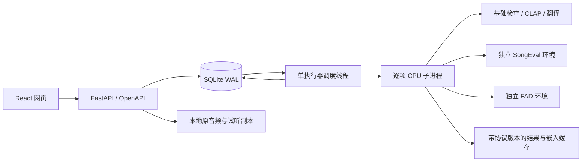

# 架构与扩展

## 组件

- `backend/app.py`：HTTP 接口、导入、音频服务、报告导出及网页静态文件。
- `backend/db.py`：SQLite 表与访问函数；样本、任务、逐项结果、缓存及投票均持久保存。
- `backend/jobs.py`：输入快照、结果签名、操作系统执行器互斥、队列恢复、子进程资源监控。
- `backend/worker.py` / `metrics.py`：CPU 推理入口及指标适配。stdout 只输出 JSON，诊断写到任务日志。
- `backend/reports.py`：仅汇总当前有效结果，按提示词等权统计、配对 bootstrap 及导出。
- `frontend/src/`：React/TypeScript 单页应用；开发时 Vite 代理 `/api`，生产构建由 FastAPI 提供。

## 数据与任务

上传先暂存并验证整批元数据，再写入样本表。音频原件以独立 ID 存储，内容用 SHA-256 标识。创建任务时冻结样本、参数、模型版本及硬件信息；后续编辑元数据不会改变正在执行的任务。

每个指标启动一个子进程。调度器轮询耗时、内存、取消标记，必要时结束该进程树并保存明确状态，随后继续其他项。完成指标可命中 SQLite 结果缓存；CLAP 与 FAD 各自有独立音频嵌入缓存。重启只重排未完成项。

无需参考库的单曲指标与需要参考集合的 FAD 分开报告。详细数学与预处理约定见 [评估协议](protocol.md)。

## 运行配置

唯一的环境变量配置是 `MUSIC_EVAL_DATA`，用于改变数据根目录；`.env` 示例不自动加载。网页运行设置持久保存于数据根目录的 `settings.json`。模型修订来自根目录 `models.lock.json`。

完整安装脚本和可选环境的解释器路径按 Windows 设计，Linux CI 覆盖基础后端测试。移植模型栈时，需要一起适配解释器路径、安装脚本和独立环境推理测试。

## 增加评估器

1. 定义指标适用性、输入及结果字段，明确单曲还是集合指标。
2. 在 `metrics.py` 实现真实适配，在 worker 分发，并更新 API/前端可选指标。
3. 在 `jobs.signature` 加入会影响结果的模型、参数及协议；对不适用情况返回跳过原因。
4. 检查是否需要独立依赖环境，并锁定版本和模型修订。
5. 补充行为测试、模型推理测试和协议文档，记录使用的输入、权重及结果。
